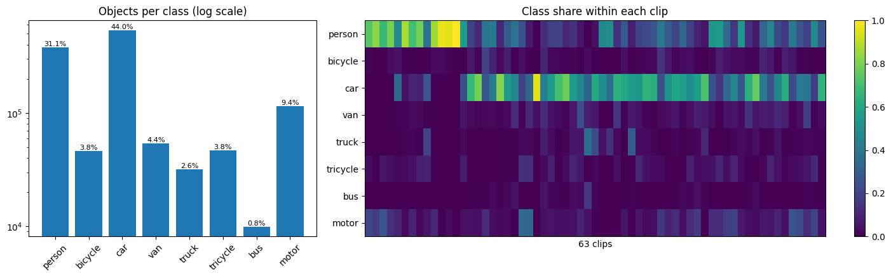
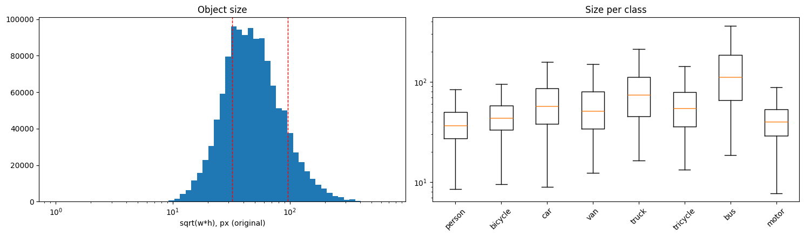
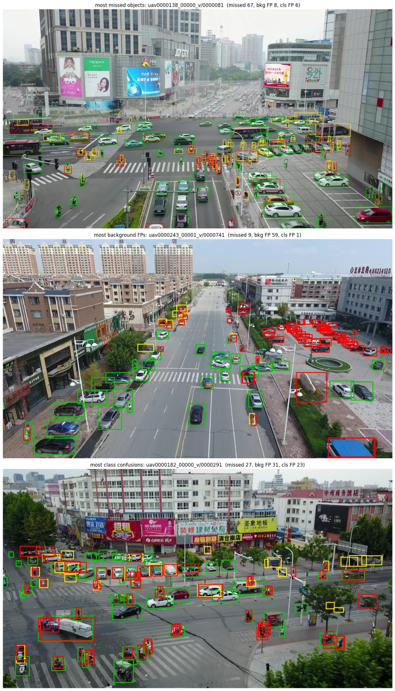
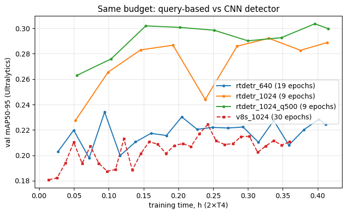
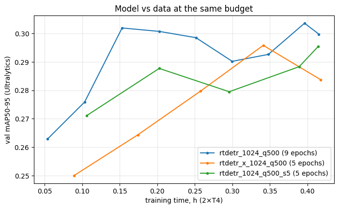
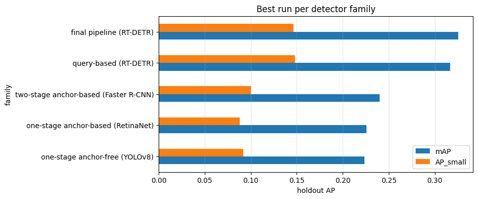

## Introduction
The task is to detect 8 classes of objects (person, bicycle, car, van, truck, tricycle, bus, motor) in every frame of 48 drone clips from VisDrone2019-VID.

## Data and validation (`eda_preprocessing.ipynb`)

| observation                      | number                                                                                                                             | decision                                                           |
|----------------------------------|------------------------------------------------------------------------------------------------------------------------------------|--------------------------------------------------------------------|
| Small objects                    | medium size is 37 px for person and 58 px for car. 24% are less than 32x32. At 640px - 54% of objects < 16px, at 1024px - only 20% | input >= 1024 px. I also tried a stride-4 head and smaller anchors |
| Dense scenes                     | 45 objects per frame on avg, max - 180                                                                                             | 500 detections per image, 500 queries for RT-DETR                  |
| Imbalance classes                | car - 44%, person - 31%, bus - 0.8%                                                                                                | look at per-class AP for every model                               |
| Ignore regions                   | 17% of the image on avg, in 72% of frames                                                                                          | painted gray in training frames, don't punish in evaluation        |
| Train and test resolution differ | ~77% of labelled clips are wider than 1360 px, but ~68% of test clips are 680-1360 px wide                                         | scale augmentation + test input size checks                        |
| Neighbour frames are similar     | IoU of the same object is 0.90 for the next frame and 0.35 after 10 frames                                                         | get every 10th frame for comparisons                               |

**Preprocessing:**
- Merge the given train and val splits (63 clips, 27047 frames).
- Export training frames once using CPU. 
- Mask ignore regions and resize the long side to <= 1344 px.
- Check coversion by drawing the exproted labels on frames.
- Use augmentation: 
  - torchvision models: horizontal flip 
  - Ultralytics: mosaics, scale +-50%, flip/HSV

**Validation:**
- Do `GroupKFold(5)` over clips so all frames in a clip are in one fold.
- Fold 0 (13 clips, 573 frames) is the holdout for every model. Models train on the other folds (2161 frames) and are validated on 573 original frames (fold 0).
- K-means for anchors are fitted only on the training folds.
- Use a single evaluator from `pycocotools` for all models. Ignore regions, max 500 detections per image.

## Detectors

All models start from COCO pre-trained weights.   
Each experiment changes one setting.

### Two-stage anchor-based: Faster R-CNN R50-FPN (`faster_rcnn.ipynb`)

| run             | change                               | mAP       | AP50  | AP_small  | AR500     | FPS | LB     |
|-----------------|--------------------------------------|-----------|-------|-----------|-----------|-----|--------|
| `frcnn_base`    | defaults                             | 0.240     | 0.471 | 0.098     | 0.406     | 5.0 | 0.2190 |
| `frcnn_anchors` | anchors 32-512 -> 16-256             | 0.232     | 0.466 | **0.104** | 0.423     | 5.0 | -      |
| `frcnn_props`   | RPN proposals 2000/1000 -> 4000/2000 | **0.240** | 0.471 | 0.100     | **0.425** | 4.7 | 0.2184 |
| `frcnn_roi`     | RoI positive fraction 0.25 -> 0.5    | 0.238     | 0.464 | 0.095     | 0.403     | 5.0 | -      |

Changing the settings didn’t really change mAP.   
Using smaller anchors and adding more proposals helps catch more objects, especially the small ones -> increase in recall and `AP_small`.  
But most of new detections get low scores, so precision doesn’t actually go up.

The RPN (Region Proposal Network) just offers boxes so if object doesn't appear at this stage, it's lost completely.
With 2000 proposals, it finds about 92% of medium and large objects if you set IoU at 0.5, but only 76% of the small ones. 
That means a lot of tiny objects are lost.

In the second stage, each proposal gets a class and the box is adjusted.
Now, 88% of medium/large and 68% of small objects are detected with the right class. 
If you raise the bar to IoU 0.7, only 29% of the small objects are found. 

**Failure cases:**

1. The model misses many small and far-away objects - about half < 16px are missed. NMS sometimes may drop cars when they're close together in a row.
2. Most false positives are parked cars. The issue may be that parking lot isn't labeled or flagged as an ignore region, so this really may be a labeling problem.
3. The model often confuses riders, motorbikes, bicycles, and tricycles. In VisDrone, a rider gets labeled as a separate box on top of the vehicle, but from above, these classes look alike. The model misses 85% of the bicycles and 56% of the vans.

### One-stage anchor-based: RetinaNet R50-FPN v2 (`retinanet.ipynb`)
| run                  | change                   | mAP       | AP_small  | AP_large  | AR500     | LB     |
|----------------------|--------------------------|-----------|-----------|-----------|-----------|--------|
| `retina_base`        | defaults (GIoU loss)     | **0.226** | 0.088     | **0.457** | 0.357     | 0.1806 |
| `retina_anchors`     | k-means anchors 9-112 px | 0.052     | 0.060     | 0.022     | 0.200     | -      |
| `retina_anchors_x05` | default anchors x 0.5    | 0.197     | **0.097** | 0.373     | **0.395** | -      |
| `retina_ciou`        | loss: GIoU -> CIoU       | 0.226     | 0.088     | 0.456     | 0.357     | -      |

**K-means anchors failed:** We used the YOLOv2 idea for clustering box sizes with k-means. It raised the IoU between anchors and boxes from 0.60 to 0.82, but assumed the anchor and the box always have the same centre. But anchors usually sit on a grid, so there are gaps, medium and large object are not recognized. The conclusion: anchor size must match the stride.    
**Half-size anchors:** 96% of boxes have a matching anchor, up from 75%. That helps small objects, but hurts large ones, so mAP actually falls.    
**CIoU instead of GIoU:** Almost the same, because RetinaNet only regresses boxes where anchors already hit IoU 0.5 or greater, so these loss functions are almost the same in this context.    
**No proposal stage:** This is a one-stage method, so it tries to classify ~190,000 anchors per frame, most of it is background. The focal loss function resolves this imbalance partially, but theres no second stage to refine box positions. Because of this, RetinaNet has worse scores for small object than Faster R-CNN hits (0.357 vs 0.425 for recall, and 0.088 vs 0.100 for AP_small).   

### One-stage anchor-free: YOLOv8s (`yolo_anchor_free.ipynb`)
| run           | change               | mAP       | AP_small  | AP_medium | AP_large  | AR500     | FPS | LB         |
|---------------|----------------------|-----------|-----------|-----------|-----------|-----------|-----|------------|
| `v8s_640`     | baseline             | 0.168     | 0.063     | 0.140     | 0.364     | 0.275     | 53  | 0.2085     |
| `v8s_1024`    | input 1024 px        | **0.224** | **0.092** | **0.201** | 0.410     | 0.341     | 34  | **0.2271** |
| `v8s_p2_1024` | + stride-4 (P2) head | 0.215     | 0.084     | 0.184     | **0.413** | **0.347** | 25  | -          |

**No anchors:** YOLOv8 predicts distances from each grid point to 4 box sides. There is an assigner that for each object takes the top 10 points inside the box, ranked by class score and IoU. But if you have a small object (e.g. 12 pixels wide) - at stride 8, you might only get 2 candidate points. So small or crowded objects don't have enough options.    
**Input size matters:** Going from 640 to 1024 pixels gives +0.056 mPA and increases `AP_small` by 45%. That's because small objects get "bigger" in pixels and receive more candidates. The price is the speed decrease.    
**The P2 experiment:** P2 adds stride 4, so x4 points per object. Recall increases, but box precision drops, even `AP_small` drops. That's because the new layers start from scratch, and there's not enough data to train them well.   

**Comparison:** YOLOv8s matches RetinaNet on small and medium objects, but is about 7 times faster. 0.016 mAP below Faster R-CNN on the holdout, but on the LB it is higher (0.2271 vs 0.2190).

### Query-based: RT-DETR-L (`rtdetr.ipynb`)

| run                | change                 | mAP       | AP_small  | AR500     | FPS | epochs in 0.41 h | LB         |
|--------------------|------------------------|-----------|-----------|-----------|-----|------------------|------------|
| `rtdetr_640`       | defaults (300 queries) | 0.242     | 0.097     | 0.400     | 13  | 19               | -          |
| `rtdetr_1024`      | input 1024 px          | 0.302     | **0.154** | 0.464     | 7   | 9                | -          |
| `rtdetr_1024_q500` | 300 -> 500 queries     | **0.317** | 0.148     | **0.494** | 7   | 9                | **0.3414** |

**Matching instead of NMS:** With Hungarian matching, every object gets exactly one query. Other queries on the same object are labeled as background. The model learns to handle duplicates on its own, so NMS is not needed. The tradeoff - less training signal, one positive per object instead of 10. RT-DETR compensates using denoising and adding extra losses to each decoder layer.   
**More queries:** 500 queries give +0.03 recall and +0.015 mAP. This fits the EDA where one frame can hape up to 180 objects.    
**Small objects and dense scenes:** RT-DETR is better than all CNN detectors on every object size. The biggest advantage is on small objects (0.148 vs 0.104 at best). And dense frames are not worse than sparse ones (0.319 vs 0.291).     
**Convergence.** Both RT-DETR and YOLOv8s stop improving after about 0.15 h so the gap isn't explained by just training time. Also, RT-DETR-L is ~3 times bigger and 5 times slower than YOLOv8s.

## Final pipeline (`final_pipeline.ipynb`)

I took `rtdetr_1024_q500` as the base because it's the best on the holdout and on the public LB. Each change was tested separately with the same training time.

| block     | change                                    | holdout mAP | AP_small  | LB         |
|-----------|-------------------------------------------|-------------|-----------|------------|
| reference | `rtdetr_1024_q500` at 1024                | 0.317       | **0.148** | **0.3414** |
| model     | RT-DETR-L -> X                            | 0.305       | 0.144     | -          |
| data      | every 10th -> every 5th frame             | 0.306       | 0.144     | -          |
| inference | test input 1024 -> 1280                   | **0.325**   | 0.146     | 0.3332     |
| data      | all 63 clips, last epoch, test input 1280 | -           | -         | 0.3145     |

**Model and data:** No improvements. With the same time, RT-DETR-X and the bigger frame set got only 5 epochs instead of 9, and their learning curves were still growing. So these ideas did not fail, but rather didn't have enough time.          
**Inference:** Test input 1280 px is better on the holdout but worse on the LB. The reason may be resolution. Most holdout clips are high res, so they benefit from a bigger input size. But the LB clips are smaller, their objects at 1024 px are already bigger than in training, and 1280 px makes this worse. So my holdout cannot choose the test input size.     
**All clips.** Overall score is worse. Without a holdout I had to take the last epoch. RT-DETR validation mAP jumps up to 0.04 between epochs, so a random last epoch can be bad.       
**Final selection.** Two validated submissions that differ only in test input size:
1. `rtdetr_1024_q500` at 1024: LB 0.341, holdout 0.317.
2. `rtdetr_1024_q500` at 1280: LB 0.333, holdout 0.325.

## Unsuccessful experiments and conclusions

**Did not help:**
- k-means anchors
- smaller anchors in RetinaNet and Faster R-CNN
- 50% positive RoIs
- CIoU instead of GIoU
- P2 head in YOLOv8
- bigger model or more frames with the same training time
- 1280px test input
- training on all clips

**Helped:**
- input resolution (+0.06 mAP for YOLO and RT-DETR)
- more queries for dense scenes
- most of all, the type of detector

Models trained with scale augmentation (YOLO, RT-DETR) got the same or a higher score on the LB than on the holdout.    
Torchvision models were trained only with flips and lost 0.02-0.045 on the test set.    
This may agree with the resolution difference from the EDA.

## Reproduction

**Environment.** Kaggle notebooks, GPU T4 x2, Internet on, Python 3.13. Pinned versions are in `requirements.txt`.

**Seeds and settings.**
- Seed 42 everywhere through `vd_utils.seed_everything` and for Ultralytics.
- `GroupKFold(5)` without shuffling, `VAL_FOLD = 0`, `STEP = 10`.

**Files.**
- `notebooks/eda_preprocessing.ipynb` ... `notebooks/final_pipeline.ipynb`: experiments with outputs.
- `notebooks/vd_utils.py`: shared code for all notebooks (data loading, export, evaluator, submission, torchvision training).

**Setup.**
1. Create a Kaggle dataset `vd-utils` with `vd_utils.py`.
2. Import each notebook (**File -> Import Notebook**). Add the competition data and `vd-utils` as inputs.

**Running.**
- Run every notebook with **Save Version -> Save & Run All**.
- Train all runs of a notebook in one version, so the latest output has all weights.

| # | notebook                  | accelerator | extra inputs (outputs of)                           | setting to reproduce all runs                            |
|---|---------------------------|-------------|-----------------------------------------------------|----------------------------------------------------------|
| 1 | `eda_preprocessing.ipynb` | CPU         | -                                                   | -                                                        |
| 2 | `yolo_anchor_free.ipynb`  | T4 x2       | `eda_preprocessing.ipynb`                           | `RUNS_TO_TRAIN = ["v8s_640", "v8s_1024", "v8s_p2_1024"]` |
| 3 | `faster_rcnn.ipynb`       | T4 x2       | `eda_preprocessing.ipynb`                           | `RUNS_TO_TRAIN = list(RUNS)`                             |
| 4 | `retinanet.ipynb`         | T4 x2       | `eda_preprocessing.ipynb`, `faster_rcnn.ipynb`      | `RUNS_TO_TRAIN = list(RUNS)`                             |
| 5 | `rtdetr.ipynb`            | T4 x2       | `eda_preprocessing.ipynb`, `yolo_anchor_free.ipynb` | `RUNS_TO_TRAIN = list(RUNS)`                             |
| 6 | `final_pipeline.ipynb`    | T4 x2       | all five notebooks above                            | none (it trains the runs it does not find)               |

Each notebook saves weights to `runs/`, holdout metrics to `results/` and a `submission_<run>.csv` of its best run.

**Final submissions:**
- `submission_rtdetr_1024_q500.csv` from `rtdetr.ipynb`;
- `submission_B_final_validated.csv` from `final_pipeline.ipynb`.

The full pipeline takes about 10 GPU hours. 14 hours with experiments

## References
- Faster R-CNN, 2015
- Feature Pyramid Networks, 2017
- Focal Loss for Dense Object Detection (RetinaNet), 201
- YOLO9000 (k-means anchors), 2016
- ATSS, 2020
- TOOD, 2021
- DETR, 2020
- DN-DETR, 2022
- RT-DETR, 2023
- GIoU, 2019
- DIoU/CIoU, 2020
- VisDrone challenge, 2021
- Microsoft COCO, 2014
- Ultralytics docs (YOLOv8, RT-DETR), torchvision detection models, pycocotools, scikit-learn GroupKFold